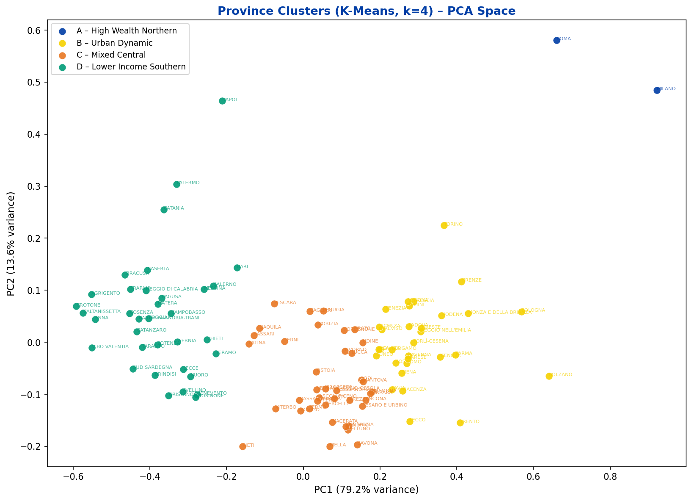
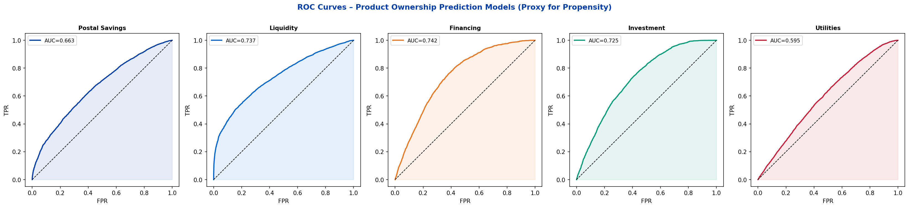
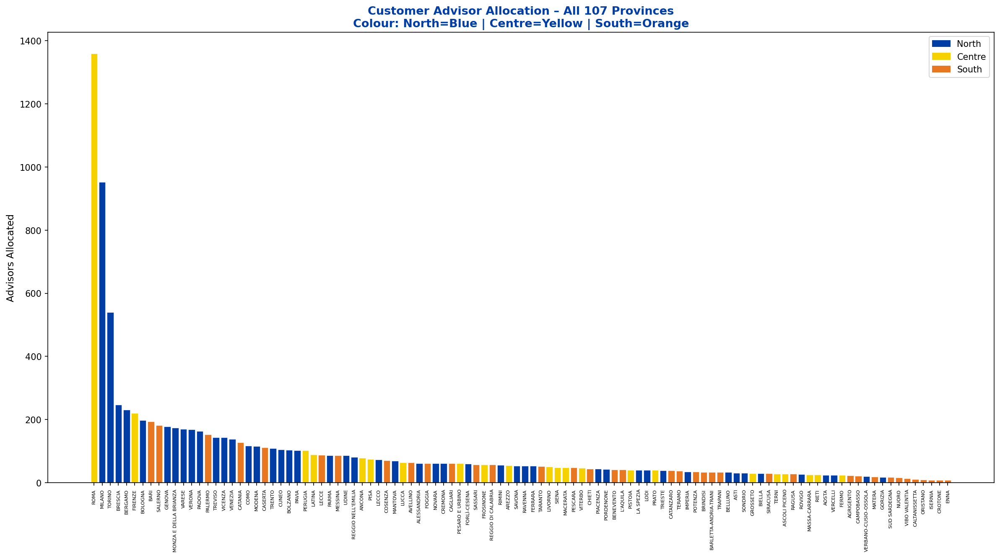

# Poste Italiane – Customer Needs & Sales Network Analysis

---

## Business Problem

Poste Italiane serves **21.9M customers** across **107 Italian provinces** but lacks visibility into where product ownership gaps exist and how to optimally allocate its **10,000 customer advisors**.

This project builds a full end-to-end data pipeline to answer: *"How do we identify unmet customer needs and deploy resources where the opportunity is highest?"*

---

## Data & Confidentiality

The datasets used in this project were provided by **Poste Italiane** for an academic challenge (LUISS Grand Challenge) under a **Non-Disclosure Agreement**. The data — internal customer records aggregated at provincial level, plus external ISTAT demographics — is confidential and **is NOT included in this repository**.

This repo contains only the **analysis code** and the **generated visual outputs** (charts and dashboard), which show aggregated, province-level patterns and cannot be used to reconstruct any raw or customer-level records. To reproduce the results, place your own copy of the source data in the project root (see *How to Run*).

---

## Project Pipeline

```
External ISTAT Data (73 variables)       Internal Customer Data (21.9M customers)
         │                                            │
         ▼                                            ▼
  Step 1: Population Needs Modeling       Step 2: Gap Analysis + ML Models
  • PCA (92.8% variance explained)        • Opportunity Gap = Need − Ownership
  • K-Means clustering (k=4)              • 5 Random Forest models (AUC 0.59–0.74)
         │                                            │
         └──────────────────┬─────────────────────────┘
                            ▼
               Step 3: Sales Network Sizing
               • Score-based advisor allocation
               • 10,000 advisors across 107 provinces
```

---

## Results

### Province Clusters (K-Means, k=4)
| Cluster | Provinces | Profile |
|---------|-----------|---------|
| A – High Wealth Northern | Milano, Bolzano, Bologna | High investment & financing need |
| B – Urban Dynamic | Roma, Torino, Firenze | Balanced needs, high utilities |
| C – Mixed Central | Mid-tier provinces | Postal savings dominant |
| D – Lower Income Southern | Calabria, Sicily, Campania | Liquidity priority |

> PCA: PC1 = 79.2%, PC2 = 13.6% → **92.8% total variance explained**


*107 provinces clustered by need profile (K-Means, k=4) projected onto the first two principal components.*

### ML Model Performance (Random Forest)
| Product | Test AUC | CV AUC | PR-AUC |
|---------|----------|--------|--------|
| Financing | 0.742 | 0.738 | 0.275 |
| Liquidity | 0.737 | 0.738 | 0.853 |
| Investment | 0.726 | 0.729 | 0.429 |
| Postal Savings | 0.663 | 0.661 | 0.728 |
| Utilities | 0.595 | 0.589 | 0.375 |


*ROC curves for the five product-ownership models; AUC ranges 0.60–0.74, evaluated with cross-validation and PR-AUC to handle class imbalance.*

### Advisor Allocation
```
Score = Customers × (Opportunity Gap + 0.1) × (1 – Digital Score)
```
| Region | Advisors | Share |
|--------|----------|-------|
| North  | 5,436    | 54.4% |
| Centre | 2,597    | 25.9% |
| South  | 1,967    | 19.7% |


*Final allocation of 10,000 advisors across all 107 provinces, coloured by macro-region.*

---

## Key Business Findings

- **Financing (2.1% ownership) and Investment (8.9%)** are the largest untapped opportunities nationally
- **North Italy has 3× higher opportunity gap** than the South — income per capita 2× higher
- **Digital customers own more products** across all categories → accelerating digital onboarding drives cross-sell depth from 1 to 3+ products
- **Seniors (66+)** are the highest postal savings segment — advisor focus recommended in central/northern provinces

---

## Outputs Generated

| File | Description |
|------|-------------|
| `outputs/fig01` – `fig21` | 21 static charts (EDA, clusters, ROC curves, feature importance, etc.) — **included in repo** |
| `outputs/interactive_dashboard.html` | Full Plotly dashboard — **included in repo**, open in browser |
| `external_enriched.csv` | 107 provinces × enriched variables — *generated locally, not committed (NDA)* |
| `gap_analysis.csv` | Need vs ownership gap by province — *generated locally, not committed (NDA)* |
| `advisor_allocation_by_province.csv` | Final advisor sizing output — *generated locally, not committed (NDA)* |

---

## How to Run

```bash
# Install dependencies
pip install -r requirements.txt

# Place data files in the project root:
# - External Data for step 1(DATA).csv
# - Internal Clients Data for step 2(...).csv

# Run the full pipeline
python poste-italiane-analysis.py

# Outputs saved to /outputs folder
```

---

## Tech Stack

| Library | Usage |
|---------|-------|
| `pandas` / `numpy` | Data wrangling, feature engineering |
| `scikit-learn` | PCA, K-Means, Random Forest, cross-validation |
| `matplotlib` / `seaborn` | Static visualisations (21 figures) |
| `plotly` | Interactive HTML dashboard |

---

## Limitations

- Need indices are heuristic proxies — no labelled demand variable was available
- ML models predict **current ownership patterns**, not future purchase intent
- No historical campaign response data available (cross-sell excluded from features to prevent data leakage)
- Network sizing optimises physical advisors only — digital channel modelled as a discount factor
